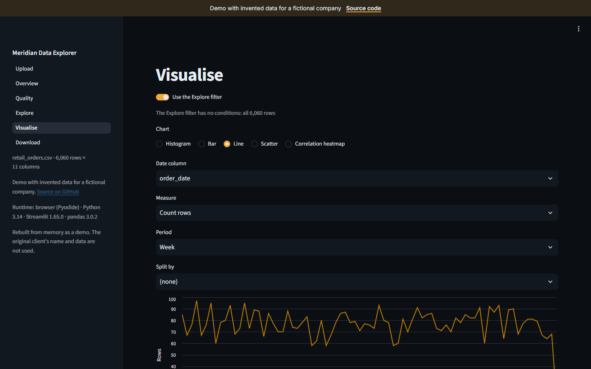
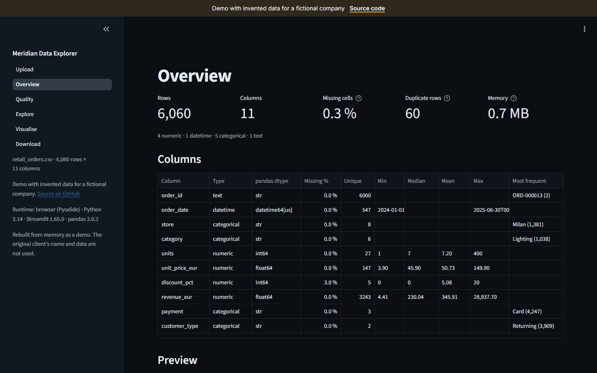
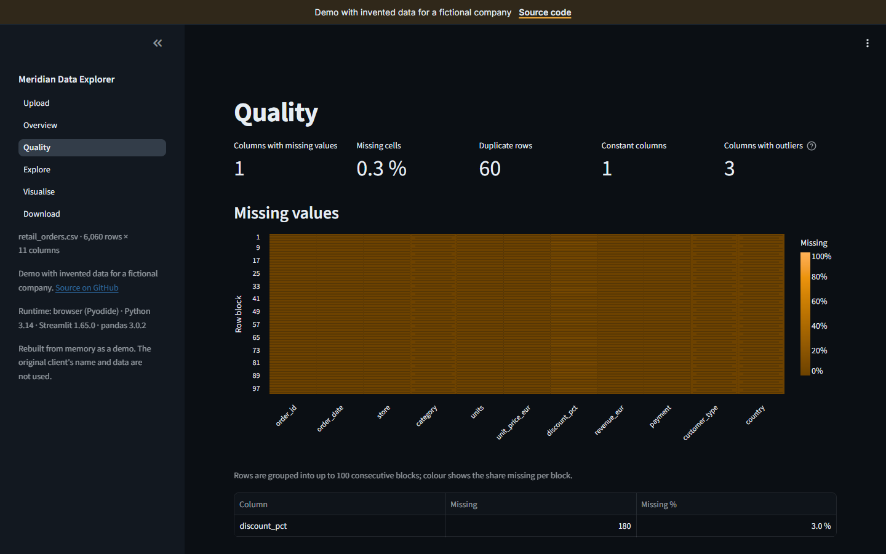
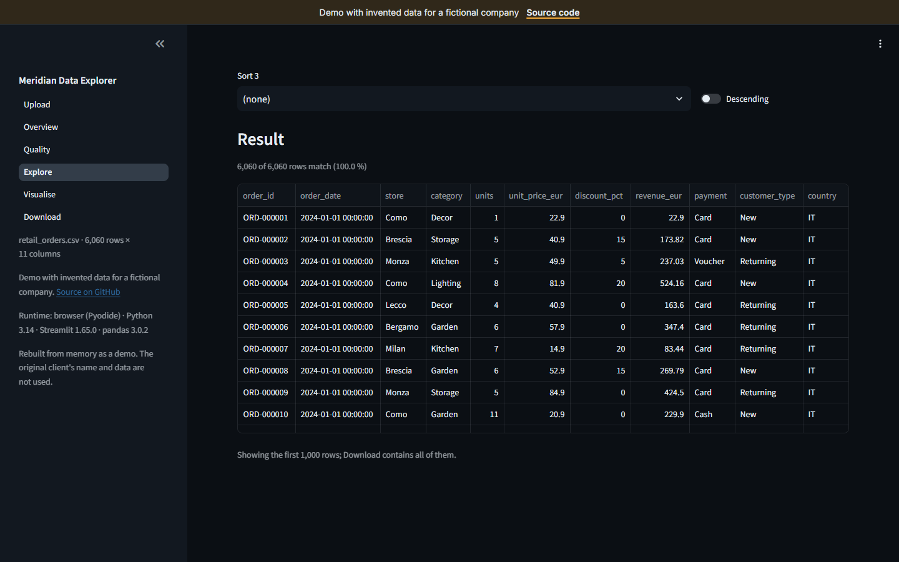
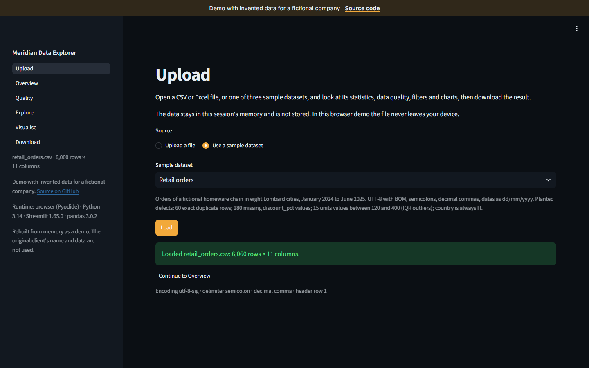
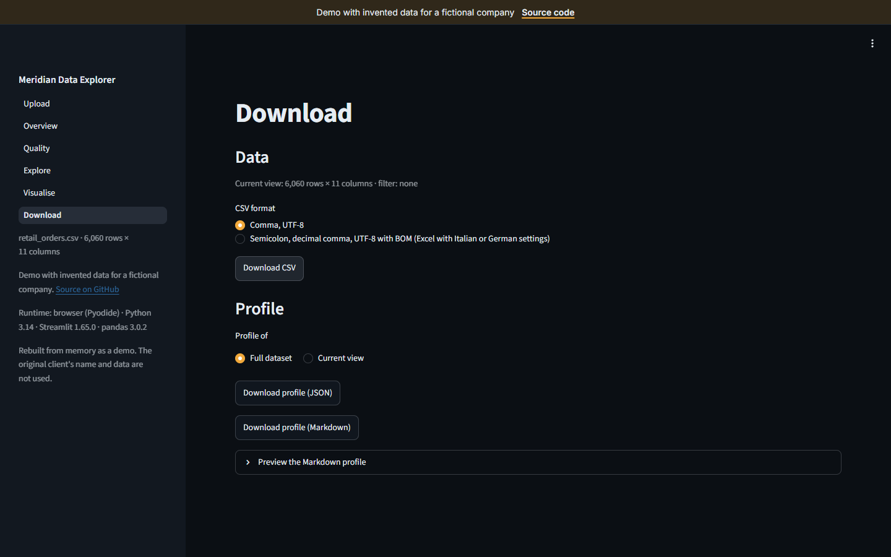
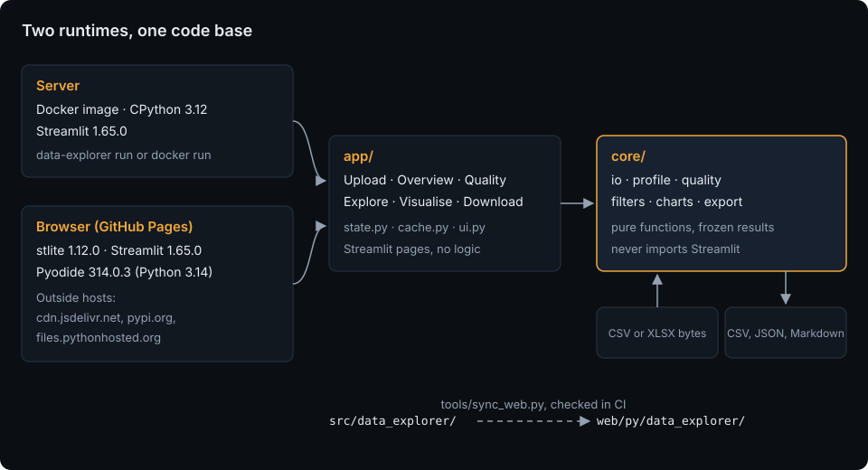

# Data Explorer App

[](https://github.com/HARISPAARTAN/data-explorer-app/actions/workflows/ci.yml)
[](https://github.com/HARISPAARTAN/data-explorer-app/actions/workflows/pages.yml)
[](https://github.com/HARISPAARTAN/data-explorer-app/releases)

CSV- oder Excel-Datei hochladen und Statistiken, Datenqualität, Filter, Diagramme und Downloads erhalten; läuft im Browser mit stlite oder auf einem Server mit Docker.

English: [README.md](README.md)

## Status

- CI am 2026-10-29 für Commit `2e665c0` bestanden: Lint, Tests auf Ubuntu und Windows mit Python 3.11, 3.12 und 3.13, die Kern-Tests auf Python 3.14, das Docker-Image mit Health-Check und der Browser-Smoke-Test ([Lauf](https://github.com/HARISPAARTAN/data-explorer-app/actions/runs/40886298431)).
- Die Live-Demo hat ihren Smoke-Test am 2026-10-29 in Chromium 156.0.8078.4 (Playwright 1.64.1) bestanden: Start, die Datensätze Einzelhandel und Umfrage, ein Diagramm, der CSV-Download, ein Upload ohne Datenversand, die Darstellung bei 390 px und die Ersatzseite ohne WebAssembly.
- Ein erster Besuch lädt 30,7 MB, davon 30,0 MB von cdn.jsdelivr.net (gemessen von diesem Smoke-Test).
- Noch kein Release.

### Bekannte Einschränkungen

- Die Browser-Version schreibt je Download-Schaltfläche zwei Meldungen in die Konsole: stlite 1.12.0 lässt Streamlit die Dateiadresse jeder Schaltfläche an einem Platzhalter-Host prüfen, der sich nie auflöst. Ein Klick auf die Schaltfläche lädt die Datei trotzdem herunter. Der Smoke-Test lässt genau diese zwei Meldungen zu und schlägt bei jedem anderen Konsolenfehler fehl; ein bestandener Test heißt also: keine unerwarteten Konsolenfehler, nicht: leere Konsole ([Details](docs/handover.md#known-console-messages-in-the-browser), Englisch).
- Ganzzahlspalten mit Jahreszahlen, etwa 2024, zeigen in der Tabelle der Seite Overview ein Tausendertrennzeichen.
- Minimum und Maximum einer Datumsspalte zeigen in der Tabelle der Seite Overview das Suffix `T00:00:00`.
- Ein geleertes Zahlenfeld in Explore zeigt 0.0.
- Das Deployment auf Pages hängt nicht von CI ab: Ein Push auf `main` geht auch dann live, wenn die CI-Jobs desselben Commits fehlschlagen ([Details](docs/handover.md#pages-deployment), Englisch).
- Im dunklen Design ist die primäre Schaltfläche weißer Text auf Bernstein und misst im Ruhezustand etwa 2,0:1; für sie wird keine WCAG-Konformität behauptet. Im hellen Design misst Weiß auf der hellen Primärfarbe 5,02:1 (`tools/checks/contrast.mjs`).

## Kundenauftrag

> Wir sind ein kleines Analytics-Team in Mailand. Mitarbeitende aus anderen Abteilungen schicken uns immer wieder CSV- und Excel-Dateien mit derselben Frage: Was steht darin, und ist es brauchbar? Wir möchten eine Web-App, in der alle im Team eine CSV- oder Excel-Datei hochladen und sofort Kennzahlen, fehlende Werte und Duplikate sehen, die Zeilen filtern, ein paar Standarddiagramme zeichnen und die gefilterten Daten zusammen mit einem kurzen Profil der Datei herunterladen können. Niemand soll dafür etwas installieren müssen. Exporte aus italienischen und englischen Excel-Einstellungen müssen beide funktionieren (Semikolons, Dezimalkommas). Bei uns läuft Python, damit wir die App später erweitern können. Kontakt: data-team@meridian.example.

Aus dem Gedächtnis als Demo nachgebaut. Name und Daten der ursprünglichen Kundschaft werden nicht verwendet. Meridian Analytics Collective ist ein erfundenes Unternehmen; Rollen, Umfang und Abnahmekriterien stehen in [docs/brief.md](docs/brief.md) (Englisch).

## Live-Demo

[harispaartan.github.io/data-explorer-app](https://harispaartan.github.io/data-explorer-app/)



Die Demo führt den Python-Code der App mit stlite und Pyodide in Ihrem Browser aus. Sie braucht WebAssembly und Module Workers, die aktuelle Versionen von Chrome, Edge, Firefox und Safari mitbringen; andere Browser zeigen Screenshots und die Befehle, mit denen sich die App lokal starten lässt. Die Demo-Seite lädt stlite und Pyodide von cdn.jsdelivr.net und openpyxl von PyPI; Ihre Dateien bleiben im Browser.

| Overview | Quality | Explore |
|---|---|---|
|  |  |  |

| Upload | Download |
|---|---|
|  |  |

## Was die App kann

- **Upload**: eine CSV-, TSV-, TXT- oder XLSX-Datei öffnen oder einen von drei Beispieldatensätzen. Kodierung, Trennzeichen, Dezimaltrennzeichen, Tabellenblatt und Kopfzeile werden erkannt und lassen sich bei einem Upload von Hand setzen.
- **Overview**: Zeilen, Spalten, fehlende Zellen, doppelte Zeilen und Speicherbedarf; eine Zeile Statistik je Spalte; die ersten 100 Zeilen.
- **Quality**: fehlende Werte je Spalte und als Heatmap, doppelte Zeilen (auch über ausgewählte Spalten), konstante Spalten und Ausreißer nach der IQR-Regel mit einstellbarem Faktor.
- **Explore**: Filter aus Widgets oder als Text, die übereinstimmen, dazu Spaltenauswahl und Sortierung.
- **Visualise**: Histogramm, Balken-, Linien- und Streudiagramm und eine Korrelations-Heatmap, über alle Zeilen oder die Explore-Ansicht.
- **Download**: die aktuelle Ansicht als CSV für Excel mit englischen oder mit italienischen bzw. deutschen Einstellungen und ein Profil der Datei als JSON oder Markdown.

## So funktioniert es



Alle Berechnungen liegen in `core/`, reinen Funktionen über pandas-DataFrames, die Streamlit nie importieren; die sechs Streamlit-Seiten in `app/` ordnen Widgets an und rufen sie auf. Dieselben Dateien laufen an zwei Orten: auf einem Server (das Docker-Image oder `uv run data-explorer run`, CPython 3.12) und im Browser (stlite 1.12.0 mit Streamlit 1.65.0 auf Pyodide 314.0.3, Python 3.14). Der Server pinnt die Versionen, die der Browser ausführt, damit die Tests die Demo beschreiben. Details in [docs/architecture.md](docs/architecture.md) (Englisch).

## Datenmodell

Ein pandas-DataFrame je Sitzung und unveränderliche Ergebnisobjekte; gespeichert wird nichts. Drei erfundene Beispieldatensätze gehören zum Paket, jeder mit Fehlern in genau festgelegter Zahl:

| Datensatz | Datei | Zeilen × Spalten | Eingebaute Fehler |
|---|---|---|---|
| Einzelhandelsbestellungen | `retail_orders.csv`: UTF-8 mit BOM, Semikolons, Dezimalkommas | 6.060 × 11 | 60 doppelte Zeilen, 180 fehlende Rabatte, 15 Ausreißer, eine konstante Spalte |
| Sensorwerte | `sensor_readings.csv`: cp1252, Kommas, ISO-Zeitstempel | 8.640 × 9 | ein 48-stündiger Sensorausfall, 30 weitere fehlende Feuchtewerte, 12 Platzhalterwerte, eine konstante Spalte |
| Kundenumfrage | `client_survey.xlsx`: zwei Tabellenblätter, Kopfzeile in Zeile 4 | 1.224 × 11 | 24 doppelte Zeilen, 37 fehlende Bewertungen, 840 leere Kommentare, 10 lange Antwortzeiten, eine konstante Spalte |

Spalten, Arten, die Filtergrammatik und die Download-Formate stehen in [docs/data-model.md](docs/data-model.md) (Englisch).

## Erste Schritte

```bash
git clone https://github.com/HARISPAARTAN/data-explorer-app.git
cd data-explorer-app
uv sync --locked
uv run data-explorer run        # startet die App auf http://127.0.0.1:8501
uv run pytest
```

Mit Docker:

```bash
docker build -t data-explorer .
docker run --rm -p 8501:8501 data-explorer
```

`uv run data-explorer run` bindet standardmäßig an 127.0.0.1; `--host` ändert das. Sie brauchen [uv](https://docs.astral.sh/uv/) und Git, Docker nur für das Image. [docs/handover.md](docs/handover.md) (Englisch) beschreibt die Umgebungsvariablen, die Logs, neue Beispieldatensätze oder Diagrammtypen und die Checkliste für das Aktualisieren der gepinnten Versionen.

## Projektstruktur

```text
src/data_explorer/   core/ (reine Berechnungen), app/ (Streamlit-Seiten), cli.py, samples/
tests/               core/, app/, tools/, golden/
fixtures/            kleine Dateien für die Einlesetests
tools/               make_data.py, sync_kit.py, sync_web.py, checks/
web/                 index.html (die stlite-Seite), kit/, py/ (synchronisierte Kopie des Pakets), assets/
docs/                Auftrag, Datenmodell, Architektur, adr/, Übergabe, screenshots/
.github/             ci.yml, pages.yml, dependabot.yml
```

## Entscheidungen

- [ADR 0001: stlite für die Live-Demo](docs/adr/0001-stlite-for-the-live-demo.md)
- [ADR 0002: Reiner Kern, dünne Streamlit-Schicht](docs/adr/0002-pure-core-thin-streamlit-shell.md)
- [ADR 0003: Flache Filtergrammatik](docs/adr/0003-flat-filter-grammar.md)
- [ADR 0004: Gleiche Versionen in Browser und Server](docs/adr/0004-browser-server-version-parity.md)
- [ADR 0005: Downloads nur als Text](docs/adr/0005-text-only-downloads.md)

Die ADRs sind auf Englisch.

## Im Vergleich zur ursprünglichen Lieferung

Dieser Nachbau ergänzt:

- einen schriftlichen Auftrag mit Abnahmekriterien und ein dokumentiertes Datenmodell;
- einen reinen Kern mit Unit- und Property-Tests und AppTest-Tests für jede Seite;
- eine Browser-Demo mit demselben Code und einem Smoke-Test in CI und nach jedem Deployment;
- ein per Digest gepinntes Docker-Image mit Health-Check und einem Benutzerkonto ohne Root-Rechte;
- Übergabenotizen mit einer Checkliste für das Aktualisieren der gepinnten Versionen;
- CI auf Ubuntu und Windows mit Python 3.11, 3.12 und 3.13 und den Kern auf Python 3.14; sie installiert mit `uv sync --locked`, pinnt setup-uv per Commit und führt den Smoke-Test mit Playwright 1.64.1 aus.

## Lizenz und Hinweis zu den Daten

MIT, siehe [LICENSE](LICENSE). Alle Datensätze in diesem Repository sind erfunden. Die App nutzt Streamlit und stlite (Apache-2.0), Pyodide (MPL-2.0), pandas und Altair (BSD-3-Clause) und openpyxl (MIT); die Schriften in `web/kit/fonts/` stehen unter der SIL Open Font License.

Aus dem Gedächtnis als Demo nachgebaut. Name und Daten der ursprünglichen Kundschaft werden nicht verwendet.
